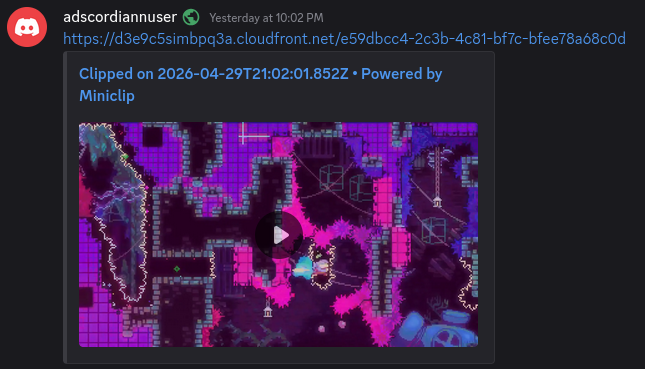
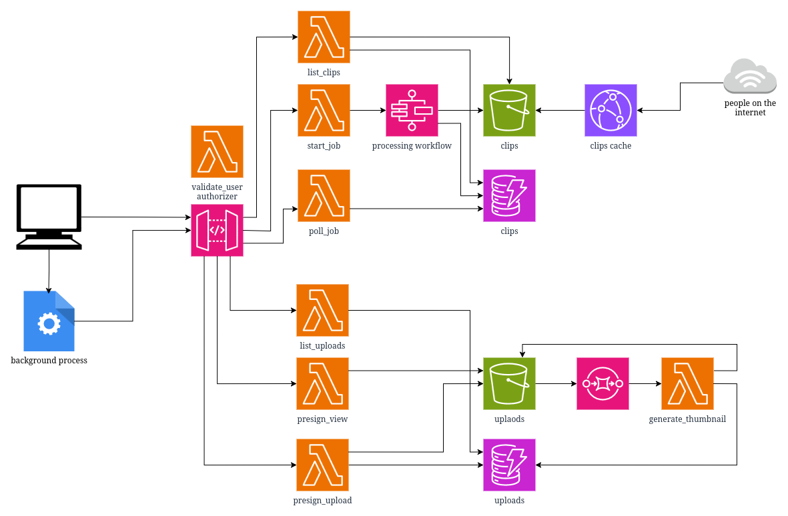

# MiniClip

A serverless app on AWS for turning gameplay recordings into shareable clips. A small watcher on your PC uploads new replays automatically. Later, you trim the part you want in the web app and get a link that shows up as a playable video in Discord and other sites.



## How it works

1. A Python watcher (`bgprocess/`) uploads new `.mp4` files from your replay folder to S3 using presigned URLs.
2. Each upload triggers a Lambda (via SQS) that generates a thumbnail with FFmpeg.
3. In the SvelteKit app you pick a start and end time. `start_job` creates a clip record and starts a Step Functions workflow.
4. The workflow validates the file, then runs FFmpeg in a Lambda to cut and compress the clip.
5. The frontend polls until the clip is done and gives you a CloudFront link to share.

## Architecture



- **Frontend:** SvelteKit
- **API:** API Gateway + Lambda, with a custom authorizer
- **Processing:** Step Functions + Lambda with an FFmpeg layer
- **Storage:** S3 (uploads and clips) and DynamoDB (uploads and clips tables)
- **Delivery:** CloudFront in front of the clips bucket, with a CloudFront Function that serves the embed metadata for Discord and similar sites
- **Infrastructure:** Pulumi (Python)

### API routes

| Method | Route | Description |
|-|-|-|
| POST | `/uploads/presign` | Get a presigned upload URL |
| GET | `/uploads/presign` | Get a presigned URL to view an upload |
| GET | `/uploads` | List your uploads |
| POST | `/jobs` | Start a clip job |
| GET | `/jobs/{id}` | Check a job's status |
| GET | `/clips` | List your clips |

## Repo layout

```
backend/lambdas/   # one folder per Lambda
bgprocess/         # replay folder watcher
frontend/          # SvelteKit app
infra/             # Pulumi code
ffmpeg/            # script to build the FFmpeg Lambda layer
```

## Getting started

You'll need AWS credentials, Pulumi, Python, Docker, and Node.

```bash
# build the FFmpeg layer
cd ffmpeg && bash script.sh && cd ..

# deploy
cd infra
pip install -r requirements.txt
pulumi up

# run the frontend (set API_BASE and CLIPS_CDN in src/lib/config.ts first)
cd ../frontend
npm install
npm run dev

# run the watcher (set API_BASE, DIR_TO_WATCH and USER_ID in main.py first)
cd ../bgprocess
pip install requests
python main.py
```

Run `pulumi destroy` to tear everything down.

## Cost

Roughly $11.50/month for 100 users, mostly CloudFront bandwidth.

## Limitations

- Auth is just a demo allow-list of user IDs, not real authentication.
- Very large videos (500MB+) may hit the Lambda timeout and memory limits.
- The frontend polls for job status instead of using WebSockets.
- Only cutting and compressing are supported so far, no cropping.